# 田园小镇 · 指令种田

> 你是东家，不亲手种地。小伟和小杨有自己的性格、情绪和想做的事；你发一句话，他们自己判断、自己走过去、自己动手，全过程都看得见。

纯前端、零运行时依赖的像素风农场小游戏：Canvas 2D + 原生 ES Module，所有画面都是代码画出来的，没有外部美术素材。

> 完整规则见 **[docs/游戏规则.md](docs/游戏规则.md)**；仓库简介 / Topics / 上传步骤见 **[docs/仓库介绍.md](docs/仓库介绍.md)**。

---

## 快速开始

```bash
npm run dev      # 本地服务器，默认 http://localhost:5180
npm run build    # 生成 dist/，可直接静态部署
```

端口被占用会自动顺延。手机竖屏优先（390×844），横屏、平板、桌面浏览器都支持。

---

## 截图

| 竖屏界面 | 横屏界面 |
|---|---|
| 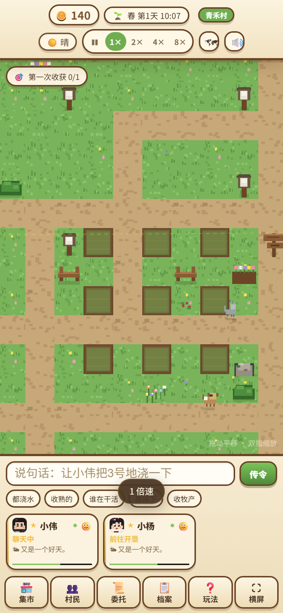 | 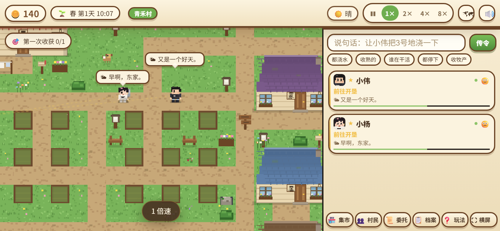 |

| 世界地图 | 区域地图图集 |
|---|---|
| 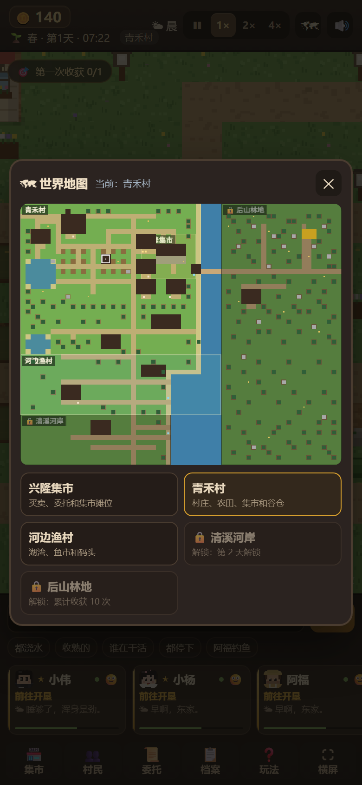 | 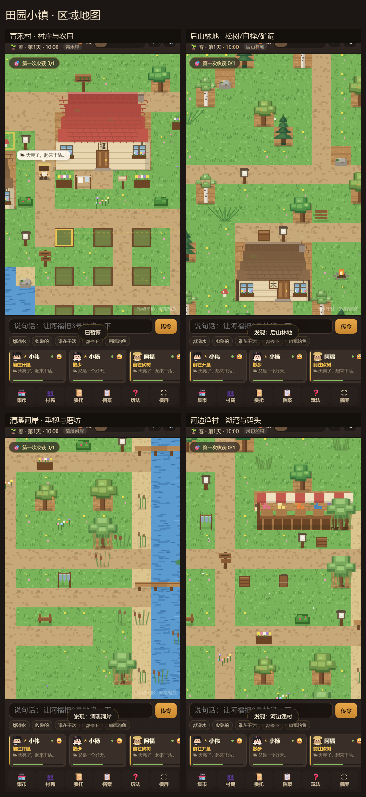 |

| 性格与心愿 | 每日小结 |
|---|---|
| 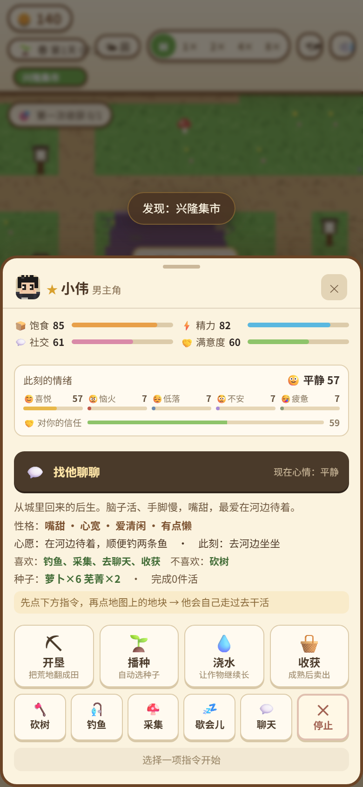 |  |

| 牧场动物 | 6 种树木 |
|---|---|
| 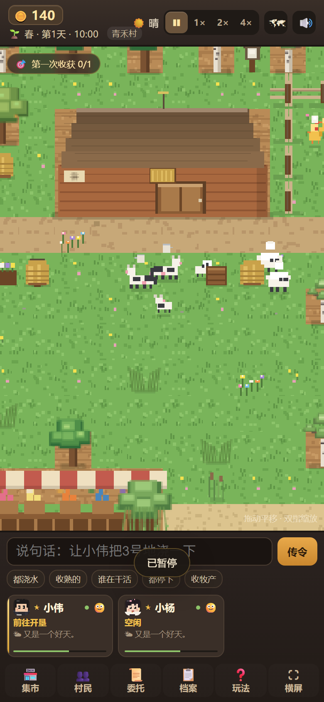 | 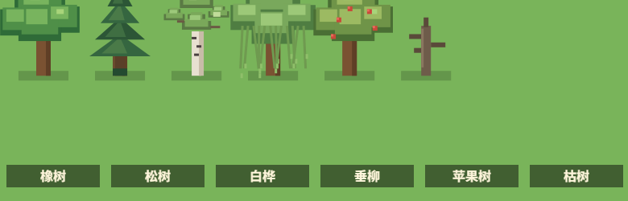 |

| 5 种作物 | 成就 |
|---|---|
| 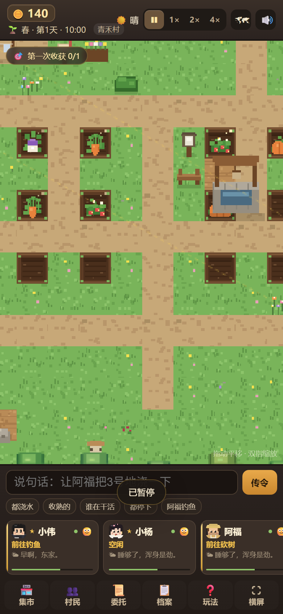 | 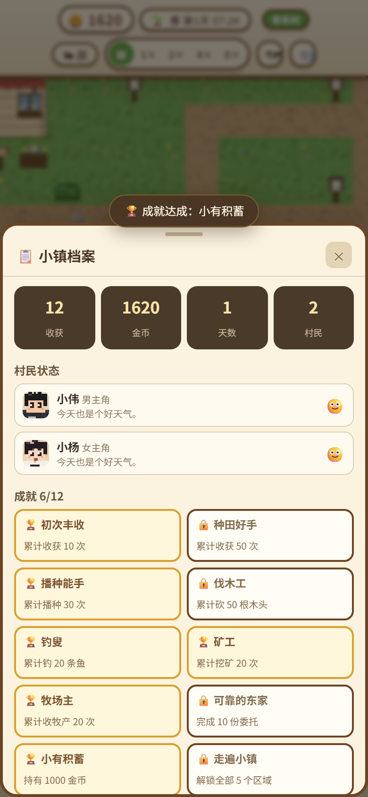 |

| 雨天 | 暴雨 |
|---|---|
| 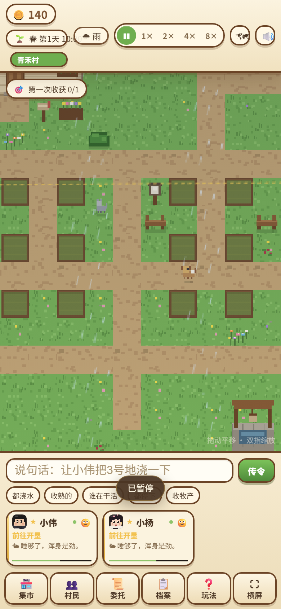 | 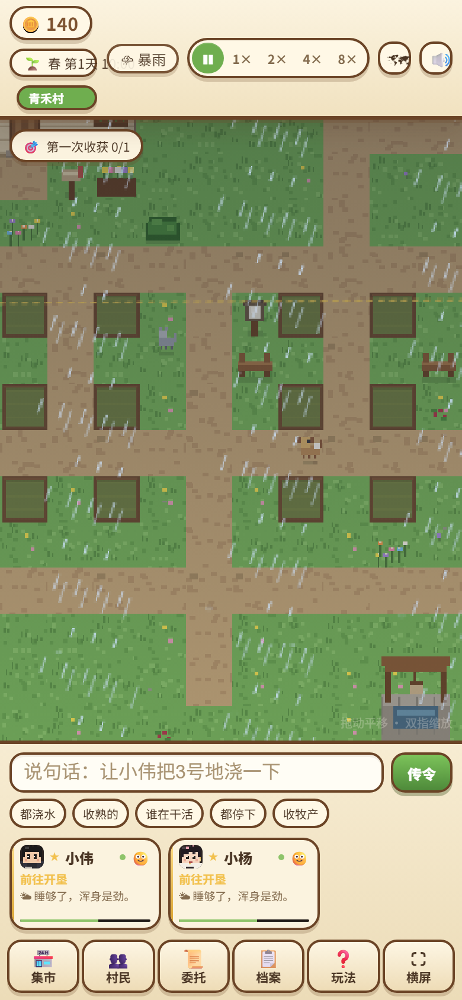 |

| AI 设置 | AI 自主对话 |
|---|---|
| 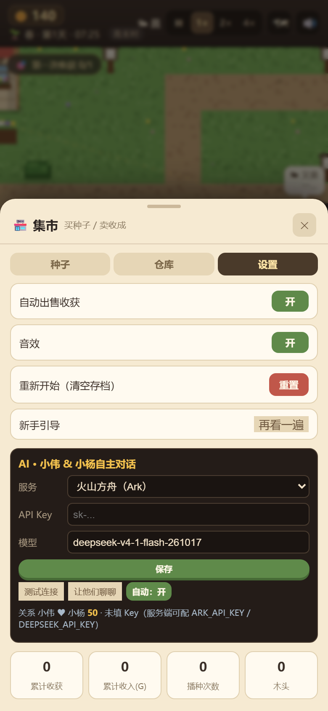 | 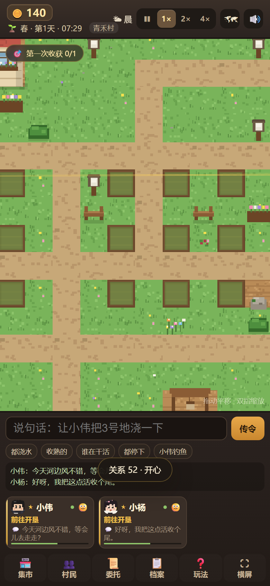 |

---

## 怎么玩

1. **选人**：点下方村民卡片（小伟 / 小杨），他头顶会出现选中光圈和想法。
2. **传令**：底部输入框直接说人话，或者用快捷指令。
3. **跟随**：点地图上的小伟或小杨，视角会跟着他移动，顶部出现「👁 跟随」提示；点 ✕ 或拖动地图取消。
4. **看执行**：他会自己寻路、绕开障碍、干活、搬运，进度环和想法实时可见。
5. **循环**：开垦 → 播种 → 浇水 → 收获 → 卖钱 → 买种子/升级。

时间：游戏内 1 小时 = 现实 5 秒，一天约 2 分钟；支持 暂停 / 1× / 2× / 4× / **8×**。

---

## 自然语言指令

底部常驻输入框，聊天和下令同一个入口：

| 说法 | 效果 |
|---|---|
| `小伟把3号地浇一下` | 指定小伟去 3 号地 |
| `把干的地都浇了` | 自动选人，按地块拆给多人 |
| `小伟和小杨把西边的地都浇了` | 两人都派，按范围分 |
| `浇一下` | 反问「浇哪几块？」，回 `全部` / `西边` / `3号地` 补全 |
| `都停下` | 清空当前任务和队列 |
| `现在谁在干活` | 汇报每个人在干什么、进度 |
| `挤奶` / `剪羊毛` / `收蛋` / `收牧产` | 去收牛奶、羊毛、鸡蛋 |
| `去后山挖两块矿` | 跨区找矿点，自动过桥 |
| `去后山砍两棵树` | 只找后山范围内的树 |
| `小杨别浇了去钓鱼` | **改令**：停下原活，改去钓鱼 |
| `小伟聊聊` / `夸夸小杨` | 走聊天，回复出现在输入框上方 |

- 没指定人时按「空闲 + 喜欢这活 + 距离近 + 精力足」自动选人
- 忙的人会排队，做完自动接下一单；队列会存档
- 批量任务全部完成会汇总一条：「都干完了：N 项。」

---

## 村民：性格、情绪与自主意愿

### 两个人

| | 小伟 | 小杨 |
|---|---|---|
| 性格 | 嘴甜、心宽、爱清闲、有点懒 | 心细、爱干净、认真、嘴硬心软 |
| 心愿 | 在河边待着，顺便钓两条鱼 | 把地种好，把家里收拾干净 |
| 自主倾向 | 去河边坐坐、钓鱼、聊天、打盹、找吃的 | 照看庄稼、看花、收拾、聊天、找吃的 |

### 自主意愿

没被派活时，他们会按当下的精力、饥饿、社交、情绪、天气和时间，自己挑一件事去做：

- 「去河边坐坐」「看看花」「收拾一下」会自己走过去、停一会儿、说句话，心情变好
- 「照看庄稼」「钓鱼」「找人聊天」会直接当成自己的活去干
- **会自己去集市买卖**：小杨发现种子不够时会走去集市买种子；小伟看到仓库堆货或缺钱时会去集市把木头、鱼、蛋、奶、羊毛卖掉
- 交易会在气泡和消息里说清楚：「买了萝卜种子×2」「把 5 个木头卖了 +70G」
- **你一发指令，他们立刻放下自己的念头先干你的活**
- 村民面板里能看到「性格 / 心愿 / 此刻在想什么」

### 情绪与需求

- 5 条独立情绪：喜悦 / 恼火 / 低落 / 不安 / 疲惫，加上对你的信任
- 干喜欢的活、挨饿、被逼着干、被夸、被冷落都会改变情绪；情绪影响干活速度和说话语气
- 需求：饱食、精力、社交；太低会罢工去吃饭/休息

### 关系

- 小伟和小杨有独立 **关系值**，AI 对话和日常相处会改变它
- 60 / 75 / 90 三档会触发关系里程碑对话

---

## AI 角色对话（火山方舟 / DeepSeek）

可以让他们用大模型自己聊天、发展关系：

1. **游戏内配置**：集市 → 设置 → AI 区域，选「火山方舟（Ark）」或「DeepSeek」，填 Key 和模型
   - Ark 默认模型：`deepseek-v4-1-flash-261017`
   - DeepSeek 默认模型：`deepseek-chat`
2. **服务端 Key（推荐）**：
   ```powershell
   $env:ARK_API_KEY="你的方舟 Key"
   npm run dev
   ```
   页面通过 `/api/ark` 或 `/api/deepseek` 代理调用，Key 不进浏览器。
3. **自动对话**：打开「自动」后，两人都醒着且至少一人空闲时，每 45–75 秒聊一次；影响情绪、信任和关系值
4. **手动触发**：点「让他们聊聊」
5. 设置里会显示最近对话和关系值；没有 Key 时，本地玩法完全不受影响

> 方舟代理关闭 thinking 以省 token；浏览器直连第三方 API 可能被 CORS 拦住，优先走本地代理。

---

## 地图与区域

64×52 无缝大世界，5 个区域，顶栏 🗺 打开世界地图并快速前往：

| 区域 | 内容 | 解锁 |
|---|---|---|
| 青禾村 | 村庄、农田、集市、谷仓 | 开局 |
| 兴隆集市 | 摊位、广场、委托板 | 开局 |
| 河边渔村 | 湖湾、鱼市、码头、钓鱼点 | 开局 |
| 清溪河岸 | 磨坊、河道、木栈道、钓鱼点 | 第 2 天 |
| 后山林地 | 松林、矿点、蘑菇、伐木营地、矿洞 | 累计收获 10 次 |

- 区域有边界、解锁条件、快速前往；第一次进入会提示「发现」
- 后山要从东侧木桥过去；没解锁时闸门挡路
- 挖矿：石头 24G、矿石 55G，12 小时再生

---

## 农田与作物

- 5 种作物：萝卜 / 芜菁 / 胡萝卜 / 草莓 / 南瓜，各有生长时间和适种季节
- 每种有幼苗 / 生长 / 开花 / 成熟四个阶段，成熟形态各不相同（白萝卜根、紫顶芜菁、锥形胡萝卜、红草莓、带藤南瓜）
- 只在湿润时生长；雨天自动浇水；冬天停长
- 耕地是圆角土垄，湿润变深

---

## 牧场动物

11 种、共 17 只：鸡/小鸡、鸭/小鸭、鹅、牛/小牛、羊/小羊、猫、狗。

- 按区域活动：鸡在鸡圈，牛羊在谷仓南侧牧场，鸭鹅在渔村水边，猫狗在村里溜达
- 牧产：鸡蛋 14G、牛奶 38G、羊毛 52G，随时间积累，就绪时头顶出现图标
- 说 `收蛋` / `挤奶` / `剪羊毛` / `收牧产`，村民会去收回来
- 村民来收时动物会停下，不会走位

---

## 天气、昼夜与夜晚

- 晴 / 雨 / 暴雨，每天清晨随机；雨天自动浇地，暴雨不能钓鱼砍树
- 雨做了三层雨丝 + 风斜 + 落地涟漪；暴雨更密更快，偶尔闪电
- 昼夜光照、路灯/窗户/篝火暖光、季节粒子
- **夜晚可以跳过**：入夜后顶栏出现 🌙，手动快进到早上 6 点；集市 → 设置可打开「夜晚自动跳过」
- 每天清晨弹出**每日小结**：昨日收入 / 收获 / 完成委托

---

## 委托与成就

- **每日委托**：每天 3 份，统计「今天做了什么」，领取金币和信任
- **成就**：12 个（收获、播种、伐木、钓鱼、挖矿、牧产、委托、金币、解锁全区域、关系、AI 对话），解锁有金币奖励，档案面板可查看

---

## 阶段解锁

游戏分 8 个阶段推进，每达成一个阶段就永久解锁一块内容，并弹出阶段卡片：

| 阶段 | 条件 | 解锁 |
|---|---|---|
| 1 落脚 | 收获 1 次 | 每日委托板 |
| 2 牧歌 | 播种 3 次 | 收蛋 / 挤奶 / 剪羊毛；夜晚自动跳过 |
| 3 开市 | 累计收入 150G | 8× 速度 |
| 4 进山 | 累计收获 10 次 | 后山林地 + 挖矿 |
| 5 渔获 | 累计钓 5 条鱼 | 鲜鱼售价 +20% |
| 6 矿工 | 累计挖矿 10 次 | 矿石售价 +30% |
| 7 交心 | 小伟与小杨关系 60 | AI 自动对话 |
| 8 走遍小镇 | 解锁全部 5 个区域 | 小镇荣誉称号 |

- 阶段只升不降，进度存档；档案面板显示当前阶段和下一阶段条件
- 未解锁的功能不会消失，只是暂不可用（按钮隐藏 / 指令提示未解锁）


## 服装店

集市东侧新增 **服装店**（也可从 集市 → 服装 打开）：

- 小伟和小杨各有 **5 套新时装**：田间工装 / 河畔渔夫 / 后山矿工 / 节日礼服 / 小镇之星（小杨对应田间姑娘 / 河畔渔娘 / 花房姑娘 / 节日红妆 / 小镇之星）
- 到达对应阶段才能购买，买下后立即换上；换装会实时改变地图小人、村民头像和聊天头像
- 已购时装可随时切换，价格 120G ~ 1500G

| 时装设定（图像模型生成） | 游戏内服装店 |
|---|---|
| 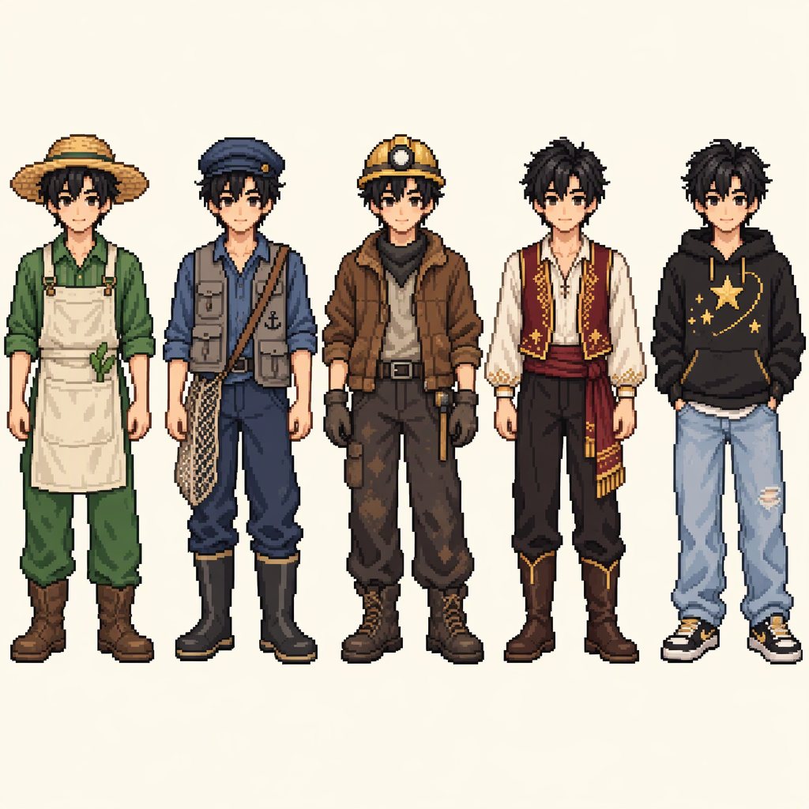 | 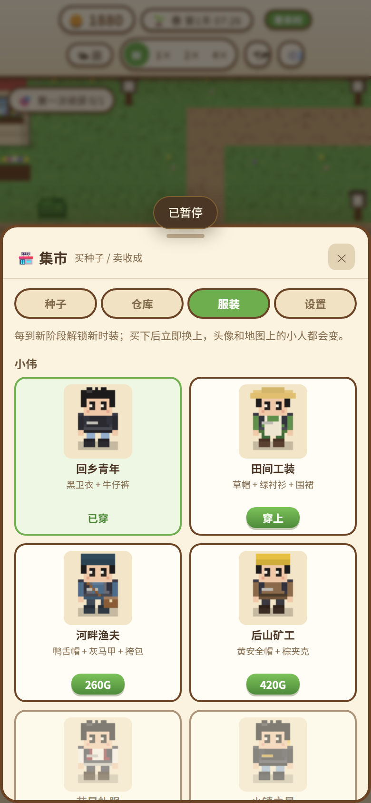 |

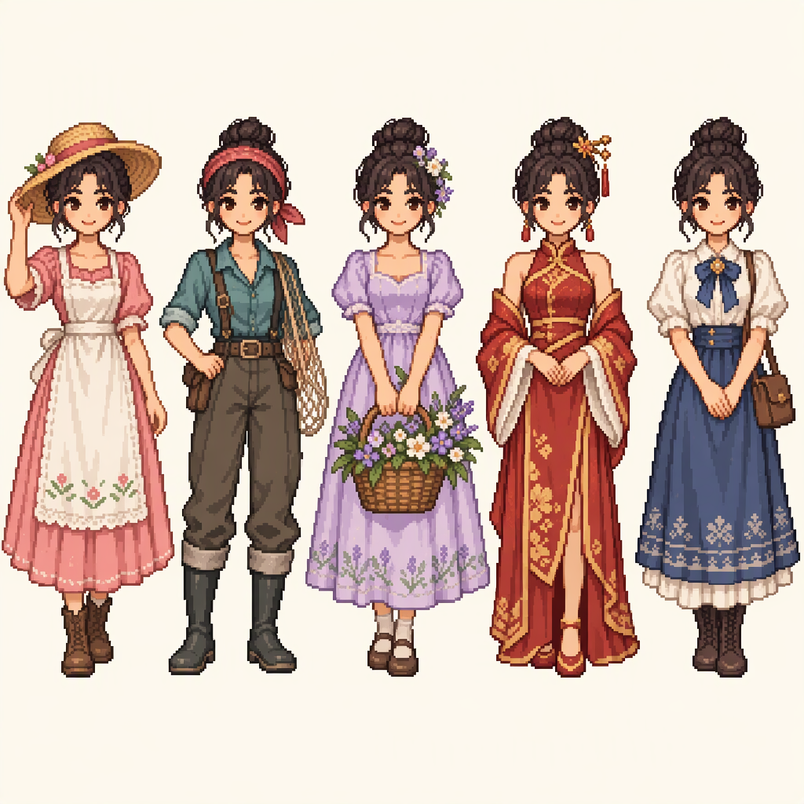

## 界面

- 视觉主题：奶油纸质面板 + 木框描边 + 圆角 + 草绿强调色
- 顶部 HUD：金币 / 日期 / 区域 / 天气 / 速度 / 地图 / 声音，竖屏整体居中，横屏收成一行
- 底部：传令输入框 + 快捷指令 + 村民卡片 + 六宫格工具栏
- 集市、仓库、委托、档案、设置、聊天、世界地图统一为纸质抽屉

---

## 手机安装

已内置 `manifest.webmanifest` + `icons/` + `sw.js`，可以当 PWA 装到手机上：

1. 电脑上运行 `npm run dev`，确保手机和电脑在同一个 Wi-Fi
2. 手机浏览器打开 `http://<电脑局域网IP>:5180/`（Windows 上用 `ipconfig` 查 IPv4）
3. 浏览器菜单 → **添加到主屏幕**，之后可以全屏打开
4. 也可以把 `dist/` 整个文件夹部署到任意静态服务器

仓库里已经打包好：`release/田园小镇-手机版.zip`（解压即 dist 内容，含安装说明）。

> Service Worker 需要 HTTPS 或 localhost 才会启用离线缓存；局域网 HTTP 下浏览器会忽略，但游戏照常运行。

## Godot 版

除了网页版，仓库里还有一个 **Godot 4.7.2 原生工程**（`godot/`），核心玩法已经跑通并做过一轮优化：

- **四区域大地图**（80×56：青禾村 / 西岭果园 / 后山林地 / 湖畔渔村）、双木桥与码头、A* 寻路（引擎 AStarGrid2D）
- **50 块农田 + 5 种作物 + 四季阶段 + 四段造型**、21 只动物与牧产、砍树/钓鱼/挖矿
- **村民 v2**：重画像素模型（四方向、表情、走路摆动、手里工具、头顶名牌）+ 情绪五维、信任、需求、**自主意愿**（湖边发呆/钓鱼/打盹/看花/收拾/聊天/自己买卖）
- **每日委托、9 个成就、8 阶段解锁、服装店 10 套时装**、全量存档
- 昼夜灯光、雷雨涟漪、四季粒子、奶油纸质 UI

```powershell
& "D:\文档\Godot_v4.7.2-stable_win64.exe\Godot_v4.7.2-stable_win64.exe" --path godot

# 无头自检
& "D:\文档\Godot_v4.7.2-stable_win64.exe\Godot_v4.7.2-stable_win64_console.exe" --headless --path godot --quit-after 300 -- smoke
```

| UI 概念图（图像模型生成） | |
|---|---|
| 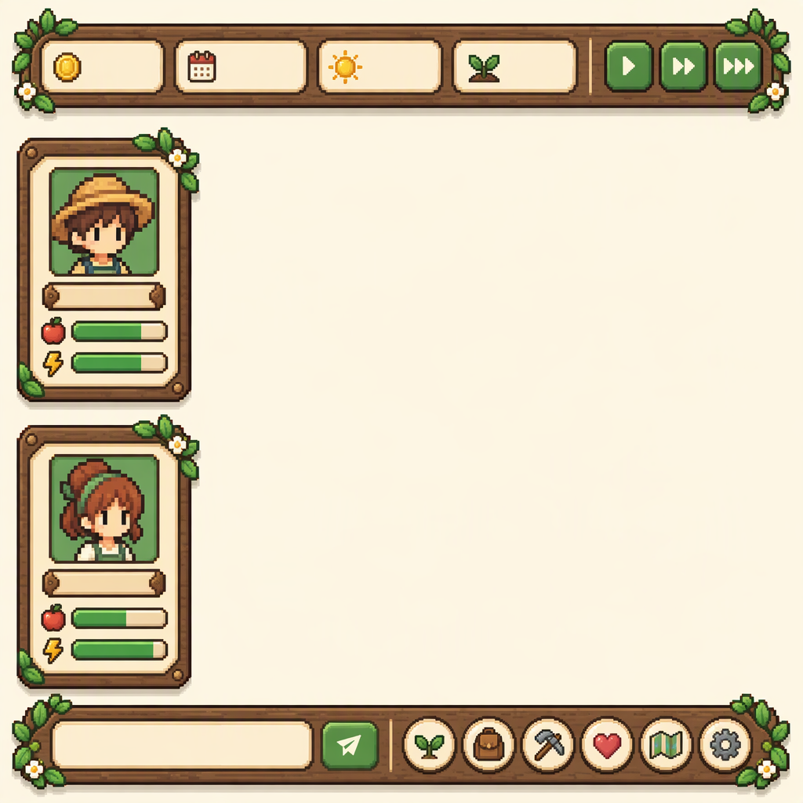 | 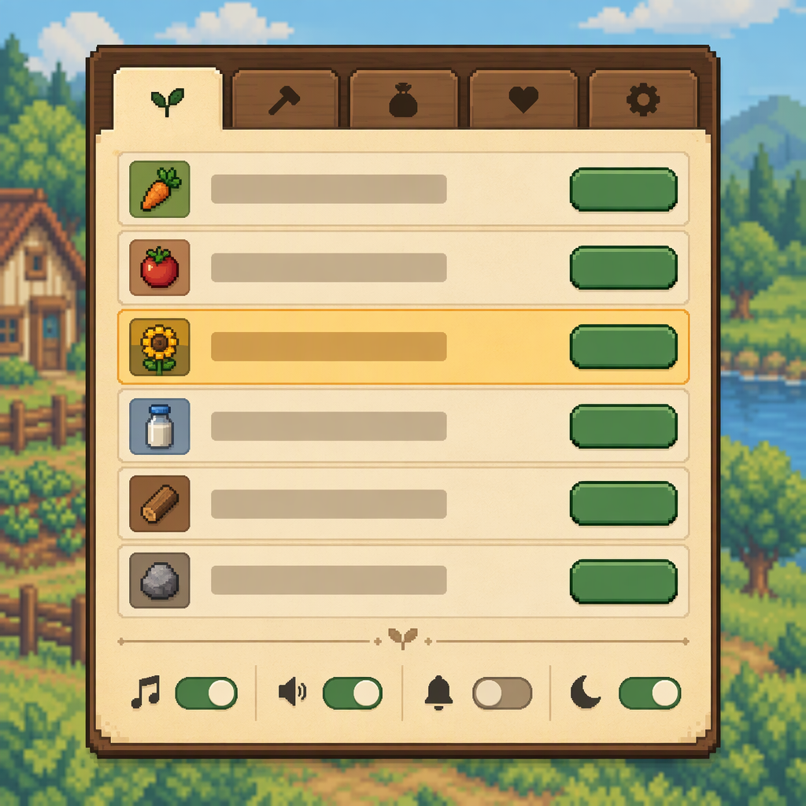 |

| 角色近景（新模型） | 农田 10×5 |
|---|---|
| 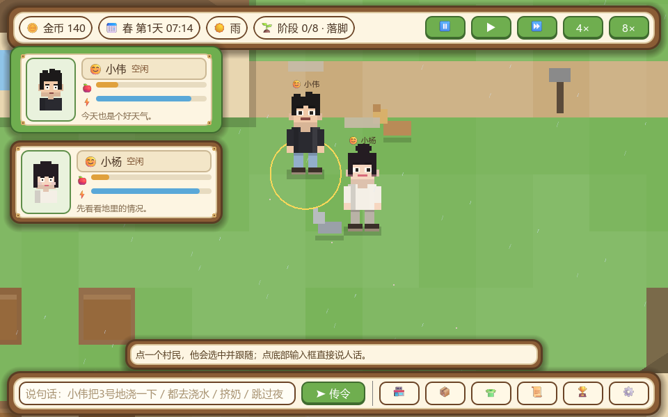 | 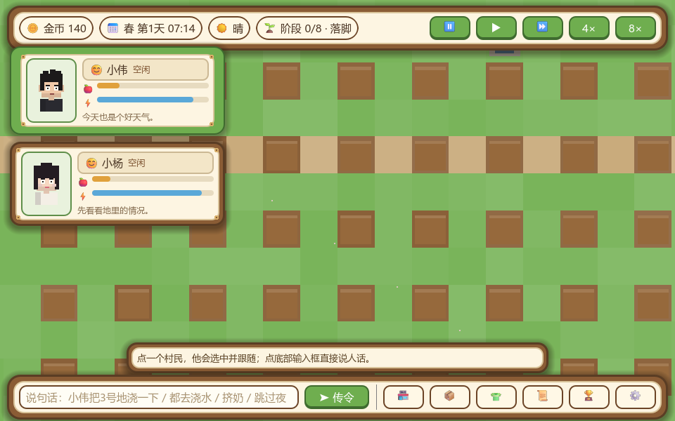 |

| 果园 | 林地 | 湖畔 |
|---|---|---|
| 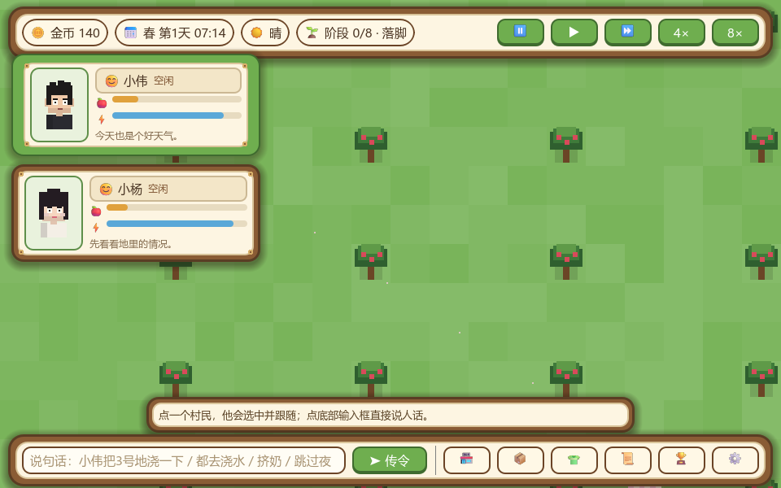 | 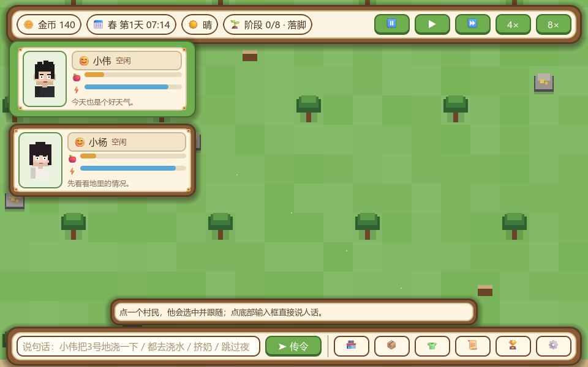 | 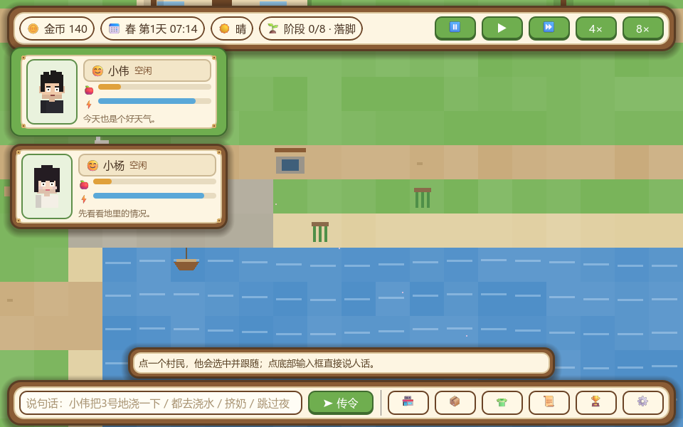 |

| 白天 | 夜晚与雨 | 服装店 |
|---|---|---|
| 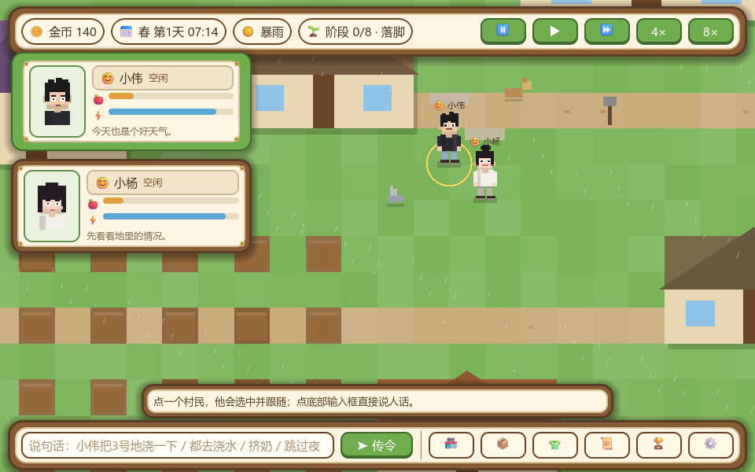 | 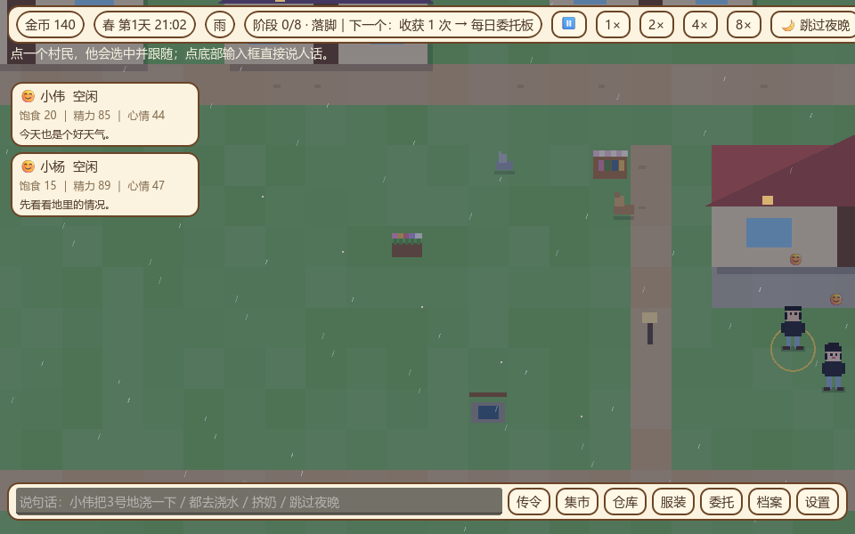 | 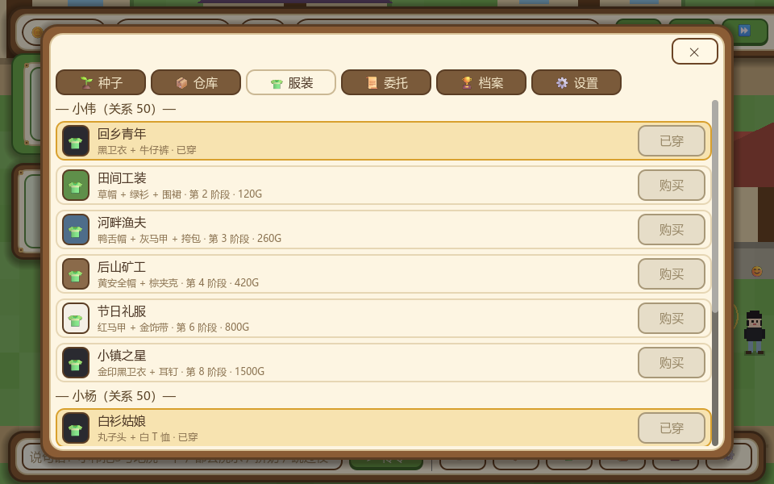 |

| 档案与成就 | 每日委托 |
|---|---|
| 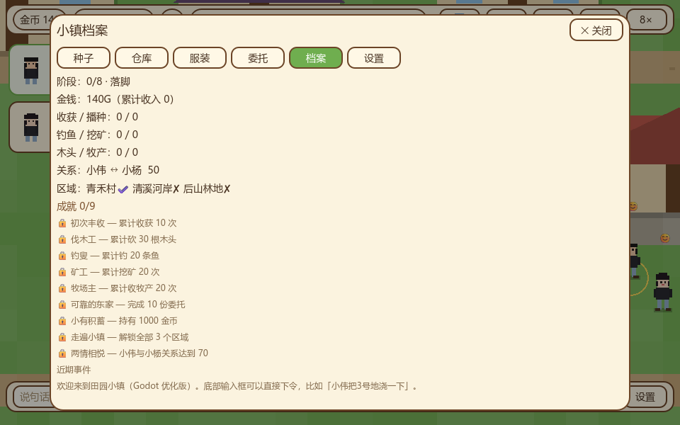 | 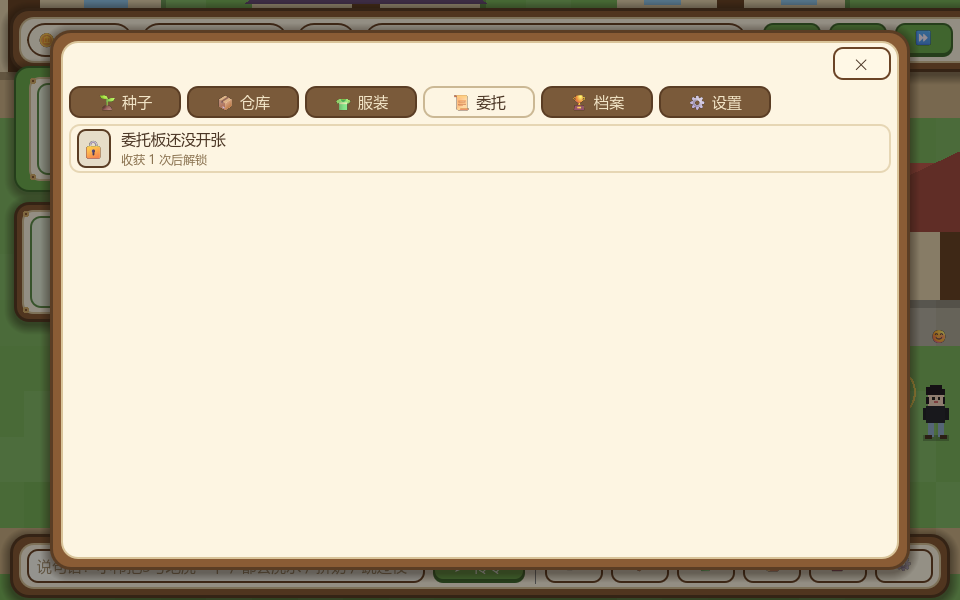 |

移植进度、架构映射与后续计划见 **[docs/godot移植说明.md](docs/godot移植说明.md)**。

## 存档

localStorage 自动存档：时间、金钱、作物、村民情绪/记忆、任务队列、区域解锁、成就、关系；AI 设置单独存放。

---

## 代码结构

```
index.html          页面骨架
styles.css          基础样式
styles-chat.css     聊天面板
styles-theme.css    视觉主题
src/
  config.js         数值、作物、村民定义、区域、指令
  world.js          地图生成：地形/建筑/树/矿/植被/动物
  sprites.js        角色像素绘制
  renderer.js       渲染：地面/物体/村民/雨雪/昼夜
  path.js           A* 寻路
  sim.js            模拟核心：时间/天气/委托/成就/存档
  villagers.js      村民 AI、需求、情绪、任务、队列
  desires.js        自主意愿
  emotions.js       情绪系统
  dialogue.js       对话生成
  commander.js      自然语言指令解析
  scheduler.js      选人、批量分发、改令
  ai-talk.js        小伟×小杨 AI 对话
  llm.js            Ark / DeepSeek 客户端
  ui.js             HUD 与所有面板
  game.js           主循环、输入、相机、音频
tools/
  serve.mjs         静态服务器 + /api/ark、/api/deepseek 代理
  build.mjs         打包到 dist/
```

---

## 已知边界

- 纯程序化像素，没有外部贴图；界面概念图只作为审美参考
- AI 对话需要自己的 API Key，会产生费用；自动频率已做限制
- 还没有独立场景切换（当前是无缝大世界 + 区域快速前往）、建造、加工、节日和完整剧情章节

---

## 路线

- 短期：动物描边与更多物种、工具栏自绘图标、建造/加工系统
- 中期：区域剧情与 NPC、节日、云存档
